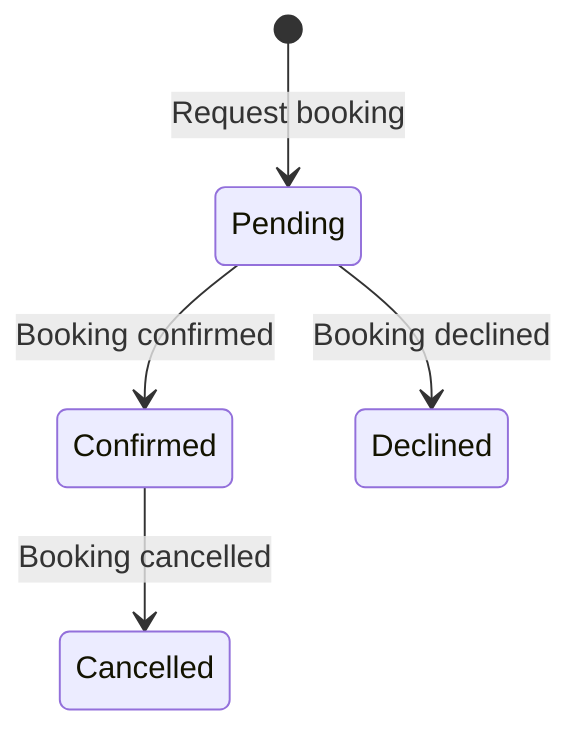

# Specifications

## Ubiquitous language

- **Slot**: a date and time range of the main hall.
- **Booking**: a resident's claim on one slot.

## Invariants

| ID | Rule | Reason | Aggregate | Decisions | Source |
| --- | --- | --- | --- | --- | --- |
| INV-001 | A slot holds at most one confirmed booking. | Prevents double booking. | Booking | D-004 | user |

## Commands

- CMD-001 Request booking. Actor: Resident. Precondition: the slot is free. Postcondition: a pending booking exists.

## Queries

- QRY-001 Is this slot free? Actor: Resident.

## Domain events

- EVT-001 Booking confirmed: the slot is now taken.

## Policies

When a booking is confirmed, every other pending request for that slot is declined.

## Lifecycles

## Contracts between actors

The manager guarantees an answer to every request. The resident guarantees to cancel a slot they no longer need.
