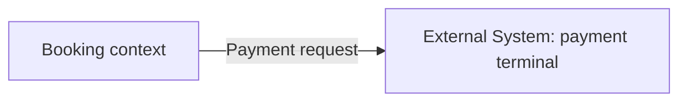

# Domain architecture

## Bounded contexts

- **Booking**: owns Slot and Booking.

## Context relationships

Booking is customer of the payment terminal, an External System, through an anticorruption layer (D-006).

## Context map

## Aggregates

### Booking

Protects INV-001.

## Fact ownership

Only the Booking context may confirm or cancel a booking (D-004).

## Published language

"Payment request" carries the booking reference and the amount.
