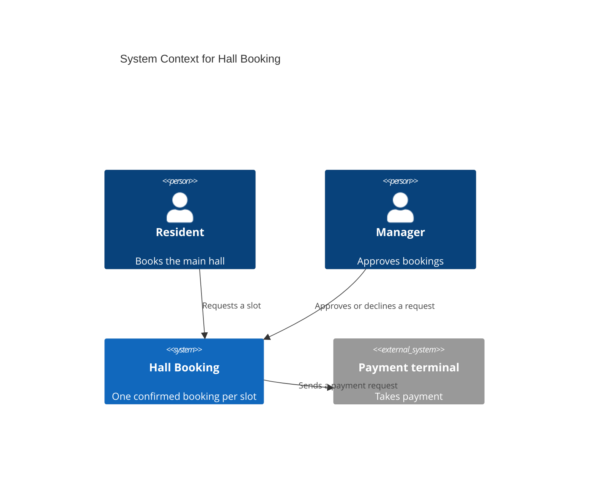
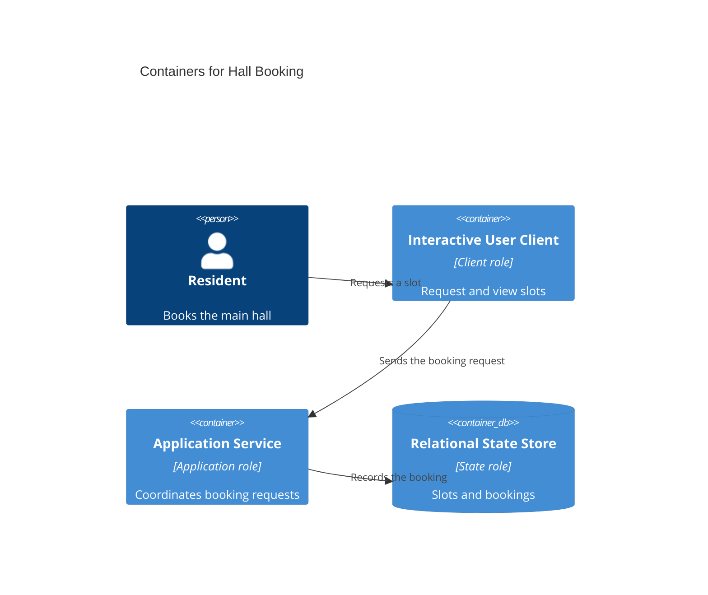
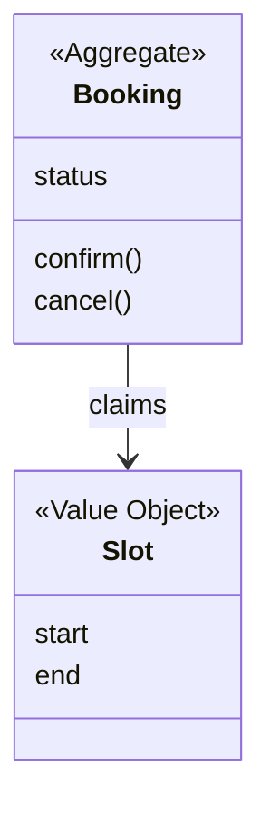

# C4 architecture

## Level 1: System context

### Purpose

Who touches the booking product, and what it hands to the payment terminal.

### Diagram

### Narrative

Payment stays outside the product (D-006).

### Boundaries considered and rejected

Taking payment inside the product was rejected (D-006).

## Level 2: Containers

### Purpose

The runnable roles inside Hall Booking.

### Diagram

### Narrative

No Message Broker: nothing asynchronous was confirmed (D-002).

### Boundaries considered and rejected

A separate Operator Client was rejected because one manager uses the same client (D-002).

## Level 3: Components

### Purpose

Parts inside the Application Service.

### Diagram

Not applicable: the Application Service has one responsibility in the MVP (D-002).

### Narrative

Revisit when recurring bookings arrive (D-003).

### Boundaries considered and rejected

None.

## Level 4: Domain structure

### Purpose

The Booking aggregate with the code removed.

### Diagram

### Narrative

Booking protects INV-001 (D-004).

### Boundaries considered and rejected

None.
